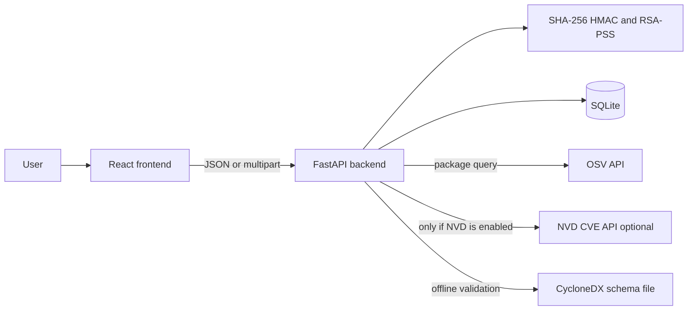

# CryptoGuard — Project Explanation for an HOD Presentation

This note is written so you can explain the project in your own words. It follows the code in this repository, not a wish list.

The application calls itself:

**CryptoGuard — Cryptographic Integrity and Software Supply Chain Verification Platform**

That full title is stored in `backend/app/core/constants.py` and `backend/app/core/config.py`. The short name everywhere is **CryptoGuard**. Version **1.0.0** comes from the backend settings and from `frontend/package.json`.

When you speak, you can also describe it as a software supply chain integrity verification framework. That phrase matches the purpose. If an evaluator looks at the screen, the title they will see is the one above.

---

## A. Project introduction

### What CryptoGuard is

CryptoGuard is a local website that checks evidence about software.

You give it a file, a message, or a short record. A Python backend then does one of three real cryptographic jobs:

- SHA-256, to see whether a file matches a digest you already trust.
- HMAC-SHA256, to see whether a shared secret authenticates a message.
- RSA-2048 with RSA-PSS and SHA-256, to sign a record and check that signature with the matching public key.

The browser does not invent the answer. The result is PASS, FAIL, or NOT VERIFIED, with a sentence that says what that word means.

The same application can also parse a `package.json` or `requirements.txt`, ask the public OSV service about exact package versions, optionally ask NVD about a CVE, and build a CycloneDX 1.7 SBOM. Those are extra supply-chain tools. They are implemented. They are not the same thing as a hash, an HMAC, or a signature.

### What software supply chain integrity means

A software supply chain is the path from a publisher to the person who runs the software. A file may be placed on a website, sent in a lab, or pulled in as a dependency.

Integrity, in this project, means: these bytes are the same bytes described by a trusted digest, tag, or signature. It does not mean “this program is safe.”

### Why integrity and authenticity matter

People often trust a file because the name looks right. A changed file can keep the same name. A changed release message can still look official. CryptoGuard gives a smaller, checkable claim: the evidence you supplied either matches or it does not.

### What problem it solves

Students and small teams need to see the difference between:

- “I calculated a fingerprint of this file.”
- “This file matches a fingerprint published by someone I trust.”
- “Someone who knows our shared secret authenticated this message.”
- “The holder of this private key signed this record.”

Mixing those ideas creates false confidence. A matching hash is not a signature. A valid signature is not a passport. An empty vulnerability search is not proof that software is safe. CryptoGuard keeps those results separate.

### Who can use it

It is a local academic application. There are no user accounts. A student, a lab partner, or a teaching assistant can run it on one computer and demonstrate the checks. It is not a public production service.

### Why it is useful in cybersecurity

It makes three standard controls visible and honest:

1. Integrity of bytes, with SHA-256.
2. Authentication of a message with a shared secret, with HMAC.
3. A signature that can be checked with a public key, with RSA-PSS.

It also shows the limit of each control in the interface, so a PASS result is harder to over-read.

### 30-second introduction

“Good morning. My project is CryptoGuard. It is a local web application for software supply chain integrity. The problem is that a file or a message can be changed and still look normal. CryptoGuard does not guess. The backend calculates a SHA-256 digest, an HMAC-SHA256 tag, or an RSA-PSS signature, and it tells you PASS, FAIL, or NOT VERIFIED. A PASS result only means the evidence I submitted matched. It does not mean the software is free of malware.”

### One-minute introduction

“Good morning. My project is CryptoGuard, a cryptographic integrity and software supply chain verification platform. Software is often trusted because the filename looks familiar or because a dependency name is well known. That is not evidence.

CryptoGuard checks three different questions. First, does this file match a SHA-256 digest from a source I trust? Second, did someone who knows a shared secret produce this HMAC tag for this exact message? Third, does this RSA public key accept a signature over this record?

The React site collects the input. The FastAPI backend does the cryptography and stores a sanitized history in SQLite. Secrets and private keys are not written into that history. If I only calculate a hash and I do not supply a reference, the result is NOT VERIFIED, not PASS. If the bytes differ, the result is FAIL. I can also show dependency lookup and an SBOM, but those answer a different question: what packages were declared, and what known advisories OSV returned. None of these checks, by themselves, prove that a program is completely safe.”

### Two-minute introduction

“Good morning. I would like to present CryptoGuard. The full title in the application is Cryptographic Integrity and Software Supply Chain Verification Platform.

The motivation is simple. In a software supply chain, a file travels from a publisher to a user. Along that path it can be replaced, edited, or described incorrectly. A student might download a virtual machine, two lab partners might exchange a status message, or a teaching assistant might sign a short release note. In each case we need a precise check, and we need to know what that check does not prove.

CryptoGuard is a local full-stack application. I open a React and TypeScript site. I upload a file or type a message. Vite serves the site, and Axios calls a FastAPI API. The Python backend hashes the file with SHA-256 in chunks, computes HMAC-SHA256 with the standard library, or signs with RSA-2048 and RSA-PSS using the `cryptography` library. SQLAlchemy stores the operation in SQLite. The stored row has the operation type, status, algorithm, filename, size, digest when relevant, and a short metadata object. It does not store the HMAC secret or the private key.

On screen, MATCH and VALID become PASS. MISMATCH and INVALID become FAIL. A hash with no reference stays NOT VERIFIED. I will demonstrate all three. After that I can open Reports and show that those real operations were recorded.

The project also includes provenance checking, a dependency scan of `package.json` and `requirements.txt`, live OSV queries, an optional NVD lookup that is off unless configured, and CycloneDX 1.7 SBOM generation. I will mention those as extra modules. The demonstration I want you to remember is the three cryptographic checks and the meaning of PASS, FAIL, and NOT VERIFIED.”

---

## B. Problem statement

People treat a familiar download as if it were authenticated. These are the practical cases CryptoGuard is built to discuss.

**A software file is modified during distribution.**  
Someone replaces or edits `lab-vm.iso` after it leaves the course page. The filename can stay the same. SHA-256 of the new file will differ from the digest published with the original. If you paste that published digest, CryptoGuard returns FAIL, shown from the backend verdict `MISMATCH`.

**A downloaded file does not match the trusted original.**  
This is the same check from the user’s point of view. You need a reference digest that you obtained from a place you trust. CryptoGuard does not fetch that reference for you. If you leave the reference empty, it still computes the digest, but the verdict is `NOT VERIFIED`. Calculating a fingerprint is not the same as checking it.

**An important software release message is modified.**  
Two people share a secret in person. One sends “The backup completed at 02:00.” with an HMAC-SHA256 tag. If the time is changed to 03:00 and the old tag is kept, verification returns FAIL, from the backend verdict `INVALID`. HMAC does not tell you whether the message, the secret, or the tag was the part that changed. The code says that limitation explicitly.

**A signed software record needs verification.**  
A teaching assistant signs “Release candidate 1.4.0” with an RSA private key and posts the public key. The class checks the signature. If the sentence is edited, RSA-PSS verification fails. If the signature matches, PASS means this public key accepts these exact UTF-8 bytes. It does not, by itself, prove the teaching assistant’s real-world identity. You still need a reason to trust that public key.

### What CryptoGuard can detect

- A file whose bytes do not match a reference SHA-256 you typed in.
- A message, secret, and HMAC tag that do not agree.
- A message, RSA public key, and signature that do not agree.
- A provenance record whose digest status and signature status differ. Those two statuses are stored and shown separately.
- Declared dependencies with exact versions that OSV reports advisories for, when the network call succeeds.
- A manifest that can be turned into a CycloneDX 1.7 JSON document and checked against the schema in the repository.

### What it cannot independently solve

- It cannot decide that a file is safe just because you hashed it.
- It cannot know whether your reference digest, shared secret, or public key came from the right person.
- It cannot identify malware. There is no malware scanner in the code.
- It does not install packages, run scripts, or scan inside archives.
- It is not a full SLSA, in-toto, or Sigstore system. Provenance here is a small signed record, and the limitation text says a valid record is not SLSA compliance.
- It has no user accounts, no login, and no authorization rules.
- An empty OSV answer is not proof that no vulnerability exists. The backend states that in the limitation text.

---

## C. Project objectives

### Implemented

- Verify file integrity with SHA-256, including a comparison with a reference digest. Implemented in `backend/app/services/integrity.py` and `backend/app/utils/files.py`. The page is Hash Checker.
- Authenticate messages with HMAC-SHA256, including generation of a one-time secret when the user leaves the secret out. Implemented in `backend/app/services/hmac_service.py`. The page is HMAC Verifier.
- Create an RSA-2048 key pair, sign UTF-8 text, and verify it with RSA-PSS and SHA-256. Implemented in `backend/app/services/signatures.py`. The page is Digital Signatures.
- Show PASS, FAIL, and NOT VERIFIED in plain language. The backend uses `MATCH`, `MISMATCH`, `NOT VERIFIED`, `VALID`, and `INVALID`. The frontend maps those words in `frontend/src/utils/format.ts`.
- Keep verification history and export it. SQLite table `verification_records`. The Reports page calls `/api/history` and `/api/history/export`.
- Keep HMAC secrets and private keys out of that history. The HMAC route saves message length and whether a secret was generated. The signature route saves key size or a SHA-256 fingerprint of the public key PEM, not the private key.
- Extra implemented modules: provenance sign and verify, dependency scanning, OSV queries, optional NVD lookup, CycloneDX SBOM generation, and a source-status page.

### Not implemented, or only partly in scope

- User accounts and access control. Not present.
- Malware detection. Not present.
- Automatic download of a vendor’s official hash. The user must paste the reference.
- A trusted public-key directory. The app can generate a key and show a fingerprint of the PEM text. It does not bind that key to a person.
- Encrypted storage of private keys. The generated PEM uses `NoEncryption()`. Protection is “do not store it on the server,” not “encrypt it at rest.”
- Full software-build attestation. Provenance is a small canonical JSON record, not a complete build system.
- NVD is implemented but disabled unless `nvd_enabled` is turned on. The default in `config.py` is `False`.
- PostgreSQL is mentioned in the README as a possible later database URL. The tested database is SQLite. No PostgreSQL driver is installed.

---

## D. Technology stack

Only technologies that appear in this repository are listed.

### Python

1. Python is the language of the backend.
2. Hashing, HMAC, signatures, parsing, HTTP calls, and database access are Python.
3. Everything under `backend/app` is Python. The README says this workspace was exercised with Python 3.13, and it asks for Python 3.11 or newer.
4. You can say: “The cryptography does not run in the browser. Python on the API does it, so the same algorithm runs for every check.”

### FastAPI

1. FastAPI is a Python framework for HTTP APIs. It also produces OpenAPI documentation.
2. It validates JSON bodies with Pydantic and exposes each check as an endpoint.
3. Routes are in `backend/app/api/routes.py`. Interactive docs are at `http://127.0.0.1:8000/docs` when the server is running.
4. You can say: “Each button on the site calls a FastAPI route, such as `/api/integrity/verify`.”

### Uvicorn

1. Uvicorn is the ASGI server that runs the FastAPI app.
2. `npm run dev` in the `backend` folder starts Uvicorn. It is not a Node API.
3. The app listens on `127.0.0.1` port `8000` in the documented command.
4. You can say: “Uvicorn is only the web server. The cryptographic code is in the service files.”

### Pydantic and pydantic-settings

1. Pydantic checks the shape of request data. pydantic-settings reads environment variables.
2. They stop malformed JSON from being treated as a successful cryptographic result.
3. Request models are in `backend/app/schemas/__init__.py`. Settings such as upload limit and database URL are in `backend/app/core/config.py`.
4. You can say: “If the HMAC tag is not 64 hex characters, the API rejects it before it pretends to verify anything.”

### React

1. React 18 is the user-interface library.
2. It renders each page and keeps form state, such as the selected file or the message.
3. Pages live in `frontend/src/pages`. `frontend/src/App.tsx` defines the routes.
4. You can say: “React is the screen. It does not decide MATCH or MISMATCH.”

### TypeScript

1. TypeScript adds types to the frontend.
2. API responses and history rows have types in `frontend/src/types.ts`, so the pages read known fields.
3. The whole `frontend/src` tree is TypeScript.
4. You can say: “TypeScript helps me not miss a field such as `verdict` or `operation_id`.”

### Vite

1. Vite is the frontend development server and build tool.
2. In development it serves the site on port `5173` and proxies `/api` to the backend when `VITE_API_BASE_URL` is not set. That proxy is in `frontend/vite.config.ts`.
3. `npm run dev` and `npm run build` in `frontend` use Vite.
4. You can say: “During a demo, the browser talks to Vite, and Vite forwards `/api` to Uvicorn, so I do not need a separate public server.”

### Tailwind CSS

1. Tailwind is a utility-CSS framework.
2. It styles the navy layout, forms, tables, and badges.
3. Classes are in the React components. Design tokens are in `frontend/src/index.css` and `frontend/tailwind.config.js`.
4. You can say: “Tailwind is presentation only. Changing a colour does not change a hash.”

### Axios

1. Axios is the HTTP client in the browser.
2. Every backend call from the site goes through `frontend/src/services/api.ts`.
3. Timeouts and connection errors are turned into readable messages there.
4. You can say: “If Uvicorn is stopped, Axios does not invent a PASS result. The page shows that the backend could not be reached.”

### Lucide React and Recharts

1. Lucide supplies the sidebar icons. Recharts draws the dashboard activity chart.
2. Icons are navigation. The chart is only drawn when the dashboard API returns activity counts.
3. Both are dependencies in `frontend/package.json`. The chart is used in `frontend/src/pages/DashboardPage.tsx`.
4. You can say: “The chart is a picture of database counts. If there are no records, I do not show a fake chart.”

### hashlib, hmac, and secrets

1. These are Python standard-library modules.
2. `hashlib` computes SHA-256. `hmac` computes HMAC-SHA256 and provides `compare_digest`. `secrets` generates the random HMAC secret.
3. File hashing is in `backend/app/utils/files.py`. HMAC is in `backend/app/services/hmac_service.py`. Comparison is in `backend/app/utils/security.py`.
4. You can say: “I did not write my own hash algorithm. I call the standard SHA-256 and HMAC implementations.”

### cryptography

1. The `cryptography` package is a Python library for RSA and other primitives.
2. CryptoGuard uses it only for RSA key generation, RSA-PSS signing, and RSA-PSS verification.
3. The code is `backend/app/services/signatures.py`. The dependency is in `backend/requirements.txt`.
4. You can say: “RSA is not from a homemade formula. The key is 2048 bits, the public exponent is 65537, and the padding is PSS with SHA-256.”

### SQLite and SQLAlchemy

1. SQLite is a file database. SQLAlchemy is the Python layer that creates tables and runs queries.
2. History, the OSV/NVD cache, and source-check rows need to survive a refresh.
3. Models are in `backend/app/models/tables.py`. The default file is `backend/data/cryptoguard.db`.
4. You can say: “After I verify a file, Reports reads a row from SQLite. It is not a list I typed into the page.”

### HTTPX

1. HTTPX is a Python HTTP client.
2. The backend uses it for OSV, optional NVD, and the CycloneDX schema status check.
3. `backend/app/services/http_client.py`, `osv.py`, `nvd.py`, and `sources.py`.
4. You can say: “Hashing does not need the internet. A dependency query does, because OSV is an external service.”

### jsonschema

1. jsonschema checks a JSON document against a JSON Schema.
2. Generated SBOMs are checked against the CycloneDX 1.7 schema stored at `backend/app/data/bom-1.7.schema.json`.
3. `backend/app/services/sbom.py`.
4. You can say: “The SBOM is not just pretty JSON. It is validated against the CycloneDX 1.7 schema shipped with the project.”

### python-multipart

1. This library lets FastAPI read form uploads.
2. File checks and manifest uploads are multipart requests, not JSON.
3. It is in `backend/requirements.txt` and used by the upload routes.
4. You can say: “The file is uploaded as form data. The server hashes it in chunks and then closes the upload.”

### pytest

1. pytest runs the backend tests.
2. It checks hashes, HMAC, signatures, history, manifests, SBOM schema validation, and OSV handling.
3. Tests are in `backend/tests`, especially `test_crypto.py`, `test_history.py`, and `test_supply.py`.
4. You can say: “The empty-file test expects the known SHA-256 of zero bytes, and it expects the verdict NOT VERIFIED because no reference was sent.”

### Vitest, React Testing Library, and jsdom

1. Vitest runs frontend tests in a simulated browser. Testing Library looks for buttons and text. jsdom provides that browser-like environment.
2. They check navigation, empty dashboard behaviour, hash-page errors, and form validation.
3. Tests are in `frontend/src/test`. The script is `npm test` in `frontend`.
4. You can say: “The frontend tests check that the page asks for a file before it calls the API. They do not replace the Python cryptography tests.”

### What is not in the stack

There is no Django, Flask, Angular, Next.js, MongoDB, Redis, or malware-scanning SDK in the project dependencies. Do not name them in the viva.

---

## 2. The three cryptographic techniques

The UI words and the API words differ on purpose.

| On screen | Backend verdict | When |
| --- | --- | --- |
| PASS | `MATCH` or `VALID` | The evidence agreed |
| FAIL | `MISMATCH` or `INVALID` | The evidence did not agree |
| NOT VERIFIED | `NOT VERIFIED` | A hash was computed and no reference was compared |

An input error, such as a short digest, is not a FAIL. The API returns HTTP 400. A stopped backend is not a FAIL either. The page shows a connection error.

### A. SHA-256

A cryptographic hash function takes bytes and returns a fixed-size digest. You cannot reliably rebuild the file from the digest. SHA-256 means the digest is 256 bits, which is 64 hexadecimal characters.

CryptoGuard reads the upload in chunks of 64 KiB, updates `hashlib.sha256()`, and discards the chunks. The maximum upload is 10 MiB, from `max_upload_bytes` in `config.py`. The file is not executed. The filename is reduced to a safe base name so a path such as `..\secret.txt` is not kept.

If you do not send a reference, the operation type is `hash` and the verdict is `NOT VERIFIED`. If you send a reference, the operation type is `hash_verify`. The reference may include a `sha256:` prefix. It is lower-cased and must be 64 hex characters. Comparison uses `hmac.compare_digest` in `digests_match`, so the code does not stop at the first different character.

PASS means the file bytes match the reference you typed. FAIL means they do not. Neither result names the author. The reference is only as trustworthy as the page or person you copied it from. A matching hash also does not prove the file is free of malware.

The digest of an empty file is a known SHA-256 test vector, and `backend/tests/test_crypto.py` expects it:

`e3b0c44298fc1c149afbf4c8996fb92427ae41e4649b934ca495991b7852b855`

That value is for an empty file only. Do not quote it as the digest of your demo file.

**Illustrative example, not a real CryptoGuard output.**  
Version A is a text file that says “Build 1”. Imagine its digest is `aaaa…01`. Version B changes one letter to “Build 2”. Imagine its digest is `bbbb…02`. Those made-up strings are only a teaching picture. In the real demo, read the digest from the screen. If the reference is the digest of Version A and you upload Version A, the screen says PASS. If you upload Version B with Version A’s digest, the screen says FAIL.

```text
File → SHA-256 calculation → reference comparison → PASS, FAIL, or NOT VERIFIED
```

### B. HMAC-SHA256

HMAC means Hash-based Message Authentication Code. A shared secret is a value both sides already know. It is not a public password printed beside the message.

The sender encodes the message and the secret as UTF-8 and calls `hmac.new(secret, message, hashlib.sha256)`. The tag is the hex digest, 64 characters. If the user omits the secret, `secrets.token_hex(32)` creates 32 random bytes, shown as 64 hex characters. A blank string is rejected. The API says to omit the field instead.

The receiver runs the same function. `verify_tag` compares the expected tag with the submitted tag using `hmac.compare_digest`. Constant-time comparison matters because a normal string comparison can stop early and leak how much of the tag matched through timing. `compare_digest` is designed to avoid that early exit. For a teaching demo the timing difference is not something you need to measure. You should still be able to say that the code uses it.

If the tag is valid, the verdict is `VALID` and the screen says PASS. If not, the verdict is `INVALID` and the screen says FAIL. The app does not say which of the message, secret, or tag was wrong.

HMAC does not identify a person and does not give non-repudiation. Anyone who knows the secret can create a valid tag. If the secret is stolen, that person can forge tags until the secret is changed. The secret must stay confidential, and it must be shared through a channel you already trust. CryptoGuard does not deliver the secret for you.

The secret and the tag are returned in the generate response so you can verify them. They are not fields in the database metadata. A test in `test_crypto.py` is named `test_hmac_api_does_not_store_secret_or_tag`. The downloadable tag report built by the HMAC page contains the message, the tag, and the algorithm name, not the secret. You should still clear the secret from the page when the demo is finished, because it remains in the browser until you do.

```text
Message + shared secret → HMAC-SHA256 → authentication tag → verification
```

Change the message, use another secret, or edit the tag, and verification fails.

### C. Digital signatures

A digital signature lets someone with a private key sign bytes, and lets other people check that signature with the matching public key.

Public-key cryptography uses a key pair. The private key must stay with the signer. The public key can be distributed to verifiers. These keys are not the same as an HMAC secret. In HMAC, both sides share one secret and either side can create tags. In this signature scheme, only the private key creates signatures.

The implementation in `signatures.py` is specific:

- RSA key size 2048.
- Public exponent 65537.
- Private key encoding: unencrypted PKCS#8 PEM.
- Public key encoding: SubjectPublicKeyInfo PEM.
- Signature padding: RSA-PSS.
- Mask generation function: MGF1 with SHA-256.
- Salt length: the SHA-256 digest length (`padding.PSS.DIGEST_LENGTH`).
- The signed input is hashed with SHA-256.
- The signature returned to the browser is base64.

Signing covers the exact UTF-8 bytes of the message, with no added newline. If you add a space, it is a different message. Verification calls `public_key.verify`. `InvalidSignature` becomes `INVALID` and FAIL. A bad PEM or bad base64 becomes HTTP 400, which the page shows as an input error, not as a cryptographic FAIL.

A valid signature proves that the private key corresponding to this public key signed these bytes. It does not prove a student’s name, a company, or a government identity. The limitation text in the code says a public key does not by itself prove a real-world identity. You need an out-of-band reason to trust the key: you received it from the signer in person, or you already know that fingerprint.

The private key is returned once in the key-generation response and kept in the browser session. The database metadata stores `private_key_stored: false` and, for sign and verify, a SHA-256 fingerprint of the public PEM text. The private key itself is not stored. The PEM is not password-protected. Do not paste it into chat, and do not leave it on a shared screen longer than the demo needs. The page hides it until you press Show.

```text
Record + private key → RSA-PSS signature
Record + public key + signature → PASS or FAIL
```

Signature validity and identity trust are different. Validity answers: “Does this key accept this signature?” Trust answers: “Do I have a good reason to believe this key belongs to the person I think it belongs to?” CryptoGuard answers the first question. You must answer the second yourself.

### D. Comparison

| | SHA-256 | HMAC-SHA256 | RSA-PSS signature |
| --- | --- | --- | --- |
| Main purpose | Show whether file bytes match a reference digest | Show whether a shared secret authenticates a message | Show whether a private key signed a record |
| Key requirement | None. You need a trusted reference digest for PASS or FAIL | One shared secret known to both sides | A private key to sign, the matching public key to verify |
| Who can verify | Anyone who has the file and the reference digest | Only someone who knows the secret | Anyone who has the public key, the message, and the signature |
| What a PASS result establishes | The bytes match the reference you supplied | The tag matches this message and this secret | This public key accepts the signature over these bytes |
| Important limitation | It does not name the publisher or prove safety | It does not identify a person, and a stolen secret can forge tags | A valid signature is not automatic proof of real-world identity |
| Example use | Compare a lab download with the digest on the course page | Confirm a short status message between two lab partners | A teaching assistant signs a release note and the class checks the posted public key |

---

## 3. The website, page by page

The routes are declared in `frontend/src/App.tsx`. The sidebar also shows supply-chain tools. They are real pages.

The shell calls `GET /api/health` and `GET /api/sources`. The footer shows the product name and, when health succeeds, version `1.0.0`. If the API is down, the banner says the backend could not be reached. That is not a cryptographic FAIL.

### Dashboard — `/`

**Purpose.** Explain the product and show real history.

**What you see.** The name CryptoGuard, the tagline “Verify Integrity. Authenticate Messages. Trust Digital Signatures.”, a Start Verification button, three feature areas, a three-step workflow, and the meanings of PASS, FAIL, and NOT VERIFIED. If the database has operations, you also see a 14-day bar chart and a breakdown of stored outcomes. Recent rows come from `recent_operations`. System health shows the live health response: API status, database status, and version. Source rows are the last stored source check, not a vulnerability score.

**Buttons.** Refresh calls `GET /api/dashboard/stats` again. Start Verification goes to Hash Checker. Feature cards and Open reports are links, not fake actions.

**API.** `GET /api/health` and `GET /api/dashboard/stats`.

**What to say.** “This page is the map. The numbers are rows in SQLite. PASS means the evidence matched. It does not mean the software is safe.”

### Hash Checker — `/integrity`

**Purpose.** SHA-256 of one uploaded file, with an optional comparison.

**What you see.** A drop zone, the filename, size, browser-reported type, and last-modified time, a reference field, and a result panel.

**Buttons.**

- Calculate SHA-256 calls `hashFile`, which POSTs the file to `/api/integrity/hash`. No reference is sent. Expect NOT VERIFIED and a 64-character digest.
- Compare Hashes submits the form and calls `verifyFile`, which POSTs the file and `reference_digest` to `/api/integrity/verify`. The same digest gives PASS. A different 64-hex digest gives FAIL.
- Copy digest copies the hex string. Download report saves the JSON response in the browser. It is not a second API.

**Algorithm.** Streaming SHA-256. Comparison uses `compare_digest`. Files over 10 MB are rejected in the browser and again on the server.

**What to say.** “I am not asking the program who wrote the file. I am asking whether these bytes match this reference.”

### HMAC Verifier — `/hmac`

**Purpose.** Create and check an HMAC-SHA256 tag.

**What you see.** Two sections, Generate and Verify. Message boxes, password-style secret fields with show and hide, and a tag field. The sample message on the generate side starts as “The backup completed at 02:00.” You can replace it.

**Buttons.**

- Generate authentication tag sends `{ message, secret }` to `POST /api/hmac/generate`. An empty secret is sent as null so the server generates one. The response includes the secret once and the tag. The verify fields are filled so you can check it immediately.
- Verify tag sends message, secret, and tag to `POST /api/hmac/verify`.
- Copy tag, Copy secret, Download tag report, and Clear secret. Clear secret only wipes the browser fields. Download does not include the secret.

**What to say.** “Both sides must already know the secret. If I change one character of the message and keep the tag, this becomes FAIL. HMAC still does not tell me the person’s name.”

### Digital Signatures — `/signatures`

**Purpose.** Generate an RSA-2048 key pair, sign a record, and verify it.

**What you see.** A key section, a sign section, and a verify section. The default message is “Release candidate 1.4.0”. The private key box is masked until you press Show. A SHA-256 of the public key text is computed in the browser for display. The authoritative signature work is still on the server.

**Buttons.**

- Generate key pair calls `POST /api/signatures/keygen`.
- Sign message calls `POST /api/signatures/sign` with the message and private key PEM. The signature and public key are copied into the verify section.
- Verify signature calls `POST /api/signatures/verify`.
- Copy and download actions. The signed-record download includes the message, signature, and public key, not the private key. Download private key is a separate, explicit button.

**What to say.** “PASS means this public key accepts this signature. I would only treat that as the teaching assistant’s signature if I already trust this public key.”

### Reports — `/reports` and `/history`

**Purpose.** Show stored operations. Both paths render `HistoryPage`.

**What you see.** Filters for operation type, status, and dates, a text filter for the loaded page, sortable columns, and pagination of 20 rows. Status badges use the same PASS, FAIL, NOT VERIFIED, or RECORDED wording. Generation and key generation are RECORDED, not PASS, because they are not verifications.

**Buttons.** Apply filters calls `GET /api/history`. Export CSV calls `GET /api/history/export`. View calls `GET /api/history/{operation_id}` and can download that JSON. Delete calls `DELETE /api/history/{operation_id}` after a confirmation.

**What to say.** “These rows are the checks I just ran. You will not find the HMAC secret or the private key in them.”

### Documentation — `/documentation`

**Purpose.** A short in-app guide: overview, why integrity matters, the workflow, the three methods, a comparison, limitations, and the demo steps.

**API.** None. The page is written in `frontend/src/pages/DocsPage.tsx`. Links to the FastAPI docs, OSV, NVD, and CycloneDX are ordinary external links.

**What to say.** “This is the same explanation I am giving you, kept inside the product.”

### Provenance Verification — `/provenance`

**Purpose.** Sign or check a small provenance JSON record. Digest status and signature status stay separate.

**Inputs.** A JSON editor, a private key to sign, a public key to verify, and an optional artifact file for the digest comparison.

**Buttons.** Sign calls `POST /api/provenance/sign`. Verify calls `POST /api/provenance/verify` as multipart form data. The signed bytes are canonical JSON, not the raw text. The signed fields are `artifact_sha256`, `builder_id`, `build_timestamp`, `source_repository`, and `source_revision`. The algorithm is the same RSA-2048 PSS-SHA256.

**What to say.** “This is a teaching provenance record. A valid signature here is not a SLSA certificate.”

### Dependency Scanner — `/dependencies`

**Purpose.** Parse `package.json` or `requirements.txt` and query OSV for exact versions.

**Buttons.** The scan calls `POST /api/dependencies/scan`. Packages are not installed. Version ranges are skipped rather than sent to OSV as if they were exact versions. NVD is not included from this form. The code sends `include_nvd` as false.

**What to say.** “No advisory from OSV means this query returned no match. It does not mean the package is safe.”

### SBOM Generator — `/sbom`

**Purpose.** Turn a manifest into a CycloneDX 1.7 JSON SBOM and validate it.

**Button.** Generate calls `POST /api/sbom/generate`. Unknown licenses and transitive dependencies are omitted, not invented. The schema file in the repo is used for validation.

**What to say.** “An SBOM is a list of declared components. It is not a vulnerability scan.”

### Vulnerability Intelligence — `/vulnerabilities`

**Purpose.** Query one package version, mainly through OSV, and optionally look up one CVE in NVD.

**Buttons.** Query calls `POST /api/vulnerabilities/query`. The NVD CVE lookup calls `POST /api/vulnerabilities/nvd`. The page reads `GET /api/health` to see whether NVD is enabled. The default configuration leaves NVD disabled.

**What to say.** “If NVD is disabled, I will say so. I will not treat a disabled lookup as a clean bill of health.”

### Datasets & Sources — `/sources`

**Purpose.** Show OSV, NVD, and CycloneDX: what they are, and whether a status check succeeded.

**Buttons.** The page loads `GET /api/sources`. Check source status calls `POST /api/sources/check`. A source status is availability, not a security verdict.

**What to say.** “Green here means the service responded. It does not mean our software has no vulnerabilities.”

### Not found

Any other path renders a 404 page with a link back to the dashboard. It does not call an API.

---

## 4. Technical architecture



### Responsibilities

The frontend collects input, checks obvious mistakes such as a short digest or a huge file, draws PASS, FAIL, and NOT VERIFIED, and offers copy or download of what the API returned.

The backend does the cryptography, rejects bad input with HTTP errors, writes sanitized history, and talks to OSV or NVD when that module is used.

### One real request, end to end

1. You choose a file and a reference on Hash Checker, then press Compare Hashes.
2. `IntegrityPage` calls `verifyFile` in `frontend/src/services/api.ts`.
3. Axios POSTs multipart form data to `/api/integrity/verify` with fields `file` and `reference_digest`.
4. In development, Vite proxies that path to `http://127.0.0.1:8000`.
5. `verify_file` in `backend/app/api/routes.py` checks the reference with `normalize_sha256`. A bad reference becomes HTTP 400.
6. `read_upload_hashed` in `backend/app/utils/files.py` streams the file through SHA-256.
7. `hash_result` in `backend/app/services/integrity.py` calls `digests_match`.
8. `envelope` in `backend/app/services/records.py` writes a `verification_records` row and returns JSON: `verdict`, `sha256`, filename, size, `operation_id`, and limitations.
9. The page maps `MATCH` to PASS or `MISMATCH` to FAIL.

### What is saved

Saved: operation id, type, status, algorithm, filename, size, SHA-256 digest for file checks, time, duration, and sanitized metadata such as the verdict or message length.

Not saved: file bytes, HMAC secret, HMAC tag, private key PEM. The public key fingerprint stored for signatures is a hash of the PEM text, not the private key.

Vulnerability responses can be cached in `vulnerability_lookup_cache`. Source checks are stored in `data_source_checks`.

### Errors

- Bad input: HTTP 400 with a detail string. The page shows that string.
- Database unavailable on health: HTTP 503, “Database is unavailable.”
- Upload too large: a payload error, also blocked in the browser at 10 MB.
- Backend not running: Axios reports that the API cannot be reached. The UI does not replace that with a successful placeholder.
- OSV or NVD failure: the dependency and vulnerability services return a source error. An empty advisory list is described as “no match,” not as safety.

### Secrets

HMAC secrets and private keys exist in the request and in the response that just created them. History metadata is built without them. The HMAC page can clear the secret from the form. The signature page masks the private key until Show is pressed. None of this is a hardware security module or an account system. It is a local demo that avoids writing those values into SQLite.

---

## 5. Security limitations and future scope

Speak these as limits, not as apologies.

**Reference hash.** PASS only compares against the digest you pasted. If you copy the digest from the same untrusted place as the file, a match proves nothing about the publisher.

**HMAC distribution.** The app will generate a secret and show it once. It does not have a safe channel for giving that secret to another person. You must already share it in person or by another trusted means.

**Private keys.** The server does not store the private key, but the PEM is unencrypted and the browser holds it for the session. A screenshot or a downloaded PEM file is a real copy of the key.

**Public-key trust.** Verification trusts whatever public key you paste. There is no certificate authority and no key directory.

**Uploads.** Files are size-limited, hashed in chunks, and not executed. That is not a full malware sandbox. The filename is cleaned, which reduces path tricks. It is not a complete content-security product.

**No malware detection.** There is no scanner. Say that in one sentence if you are asked.

**Provenance is partial.** You can sign a small record and separate digest status from signature status. That is not SLSA, in-toto, or Sigstore.

**External data.** OSV and NVD can be unavailable. Cached OSV data expires according to `vuln_cache_ttl_seconds`, which defaults to 6 hours. A cache hit is not a promise that the advisory disappeared later. NVD is off by default.

**No accounts.** Anyone who can open the local site can use it and can delete history rows. That is acceptable for a single-user lab and not acceptable for a shared production server.

**Tests.** The repository has focused pytest and Vitest tests. They are not a formal penetration test, and they do not measure performance.

### Realistic future work

Say these as future work, not as current features.

- A way to pin and label trusted public keys, still without pretending a label is a government identity.
- Stronger private-key handling, such as an encrypted PEM or keeping the key only on the user’s machine.
- Richer provenance, closer to a real build attestation, if the course later covers SLSA or Sigstore.
- Dependency and SBOM features already exist. A future version could add more ecosystems or a clearer review workflow. Do not say they are missing.
- More end-to-end tests and a locked-down deployment with access control, if the app ever leaves one laptop.
- User accounts, only if there is a real need. They are not required to explain SHA-256, HMAC, and signatures.

### Already built, so do not call them future work

- SHA-256 file hash and compare.
- HMAC-SHA256 generate and verify, without storing the secret.
- RSA-2048 PSS-SHA256 key generation, sign, and verify.
- History, CSV export, and JSON detail.
- Provenance signing of a canonical record.
- `package.json` and `requirements.txt` parsing.
- Live OSV queries and a CycloneDX 1.7 SBOM.
- Optional NVD lookup behind a setting.
