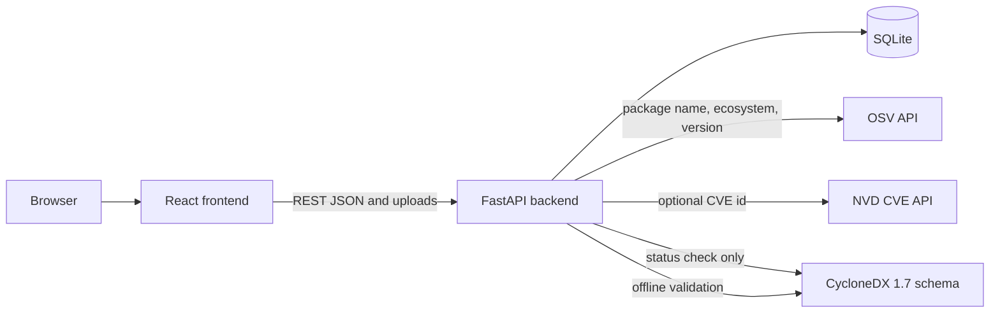

# CryptoGuard — Cryptographic Integrity and Software Supply Chain Verification Platform

CryptoGuard is a cybersecurity platform for file integrity verification, message authentication, digital signatures, provenance checks, and software dependency risk analysis.

## 1. Project title and branding

- Product name: **CryptoGuard**
- Full title: **CryptoGuard — Cryptographic Integrity and Software Supply Chain Verification Platform**
- Tagline: **Verify Integrity. Authenticate Messages. Trust Digital Signatures.**
- Short description: A cybersecurity platform for file integrity verification, message authentication, digital signatures, provenance checks, and software dependency risk analysis.

The interface, API title, database records, sample files, and this documentation use that name.

## 2. Project overview

CryptoGuard is a local full-stack web application for a cybersecurity course. A React site collects files, messages, keys, and manifests. A FastAPI backend performs the real work: SHA-256 hashing, HMAC-SHA256, RSA-PSS signatures, provenance checks, CycloneDX SBOM generation, and live vulnerability queries. SQLite stores sanitized history and a short-lived cache. The browser does not invent metrics, and the backend does not invent vulnerability records.

## 3. Abstract

Software is often trusted because a download "looks right" or because a dependency name is familiar. CryptoGuard makes a smaller and more honest claim. It can show that a file matches a reference digest, that a shared secret authenticates a message, that a public key accepts a signature, and that a manifest's exact versions have matching records in OSV. It can also say when the evidence is missing or when a data source did not answer. Those are different results, and the application keeps them separate.

## 4. Problem statement

Students and small teams need a practical way to see the difference between byte integrity, message authentication, digital signatures, and vulnerability intelligence. Mixing those ideas leads to false confidence: a matching hash is treated as a trusted publisher, or an empty vulnerability response is treated as proof of safety. CryptoGuard is a teaching platform that runs the real algorithms and the real OSV query, then labels the limits of each result.

## 5. Objectives

- Hash uploaded files with SHA-256 and compare them with a reference digest.
- Create and check HMAC-SHA256 tags without storing the shared secret.
- Generate RSA keys and sign or verify UTF-8 messages with RSA-PSS and SHA-256.
- Validate a small provenance record and keep digest status separate from signature status.
- Parse `package.json` and `requirements.txt` without installing packages.
- Query OSV for exact package versions and show the source, time, and limits of the answer.
- Generate a CycloneDX 1.7 SBOM and validate it against the official schema.
- Record sanitized history and show dashboard numbers from that database.

## 6. Scope of the project

This is a local academic MVP.

Included:

- One-file hashing and verification
- HMAC and RSA signatures for text and provenance records
- npm and Python requirement manifests
- Live OSV queries and an optional NVD CVE lookup
- CycloneDX 1.7 JSON SBOMs
- SQLite history, cache, and source checks

Not included:

- User accounts
- A packaged vulnerability dataset
- Malware detection from package names
- Full SLSA, in-toto, or Sigstore compliance
- Archive extraction, package installation, or script execution
- A separate GitHub Advisory API client
- Alembic migrations

## 7. Key features

1. Dashboard counts from the local database
2. Hash Integrity Checker
3. HMAC Authentication
4. Digital Signature Studio
5. Provenance Verification
6. Dependency Scanner
7. SBOM Generator
8. Vulnerability Intelligence
9. Datasets & Sources, with a real status check
10. Verification History with CSV export and JSON reports
11. In-app documentation and FastAPI's `/docs`

## 8. Real-world use cases

- A student downloads a class VM and checks its SHA-256 against the digest published on the course page.
- Two lab partners share an HMAC secret in person, then confirm that a status message was not edited later.
- A teaching assistant signs a short release note and the class verifies it with the posted public key.
- A project team uploads `package.json`, sees which versions are exact, and reads OSV advisories for those versions.
- The same manifest is exported as a CycloneDX SBOM for a report, with a clear note that licenses and transitive dependencies were not invented.

## 9. System architecture diagram



The schema file is also stored in the repository, so SBOM validation does not need the network. The status check is the only time the running app contacts the CycloneDX website.

## 10. Frontend, backend, and database architecture

- **Frontend.** React, TypeScript, and Vite. React Router selects the page. Axios calls `http://127.0.0.1:8000`. Tailwind CSS styles the navy and cyan layout. Recharts draws the 14-day activity chart from database counts.
- **Backend.** FastAPI routes in `backend/app/api/routes.py` call services. Services own hashing, HMAC, signatures, parsing, OSV, NVD, SBOMs, and history. Pydantic checks JSON bodies. Uploads are streamed in chunks.
- **Database.** SQLAlchemy models create three tables. The default URL is SQLite at `backend/data/cryptoguard.db`. Changing `DATABASE_URL` can point SQLAlchemy at another database later. A PostgreSQL driver is not installed in this MVP, so PostgreSQL is a designed extension rather than a tested deployment.

More detail is in `docs/ARCHITECTURE.md`.

## 11. Languages used and what each language does

- **Python:** backend and cryptographic logic. Hashing, HMAC, signatures, parsing, HTTP calls, and database access are Python.
- **TypeScript:** typed frontend application. Pages, API calls, and form checks are TypeScript.
- **JavaScript ecosystem:** frontend tooling and runtime. Vite, Vitest, and the browser run the TypeScript application through the JavaScript toolchain.
- **HTML:** page structure generated through React. `frontend/index.html` is the shell. React renders the rest.
- **CSS and Tailwind CSS:** interface styling. `frontend/src/index.css` and Tailwind utility classes set the dark navy layout, cards, forms, and buttons.
- **SQL:** database queries managed through SQLAlchemy. The application does not hand-write a separate SQL script. SQLAlchemy emits the SQL for SQLite.
- **JSON:** API payloads, configuration, provenance records, and SBOM documents.

## 12. Frameworks and libraries used

| Piece | Role |
| --- | --- |
| React 18 | User interface |
| React Router | Page navigation |
| Vite | Frontend dev server and production build |
| Tailwind CSS | Styling |
| Axios | HTTP client |
| Lucide React | Sidebar icons |
| Recharts | Activity chart |
| Vitest and React Testing Library | Frontend tests |
| FastAPI | HTTP API and OpenAPI docs |
| Uvicorn | ASGI server |
| Pydantic and pydantic-settings | Request models and environment settings |
| SQLAlchemy | ORM and SQLite access |
| python-multipart | File uploads |
| cryptography | RSA key generation and RSA-PSS |
| hashlib, hmac, secrets | SHA-256, HMAC, and secret generation from the Python standard library |
| httpx | OSV, NVD, and schema status requests |
| jsonschema | CycloneDX 1.7 validation |
| pytest | Backend tests |

Alembic is not a dependency. Tables are created on startup.

## 13. Cryptographic algorithms and explanations

### SHA-256

SHA-256 maps bytes to a 256-bit digest. CryptoGuard updates the hash with each uploaded chunk, so the whole file does not have to sit in one byte string. Comparison with a reference uses `hmac.compare_digest`, which avoids an early exit that depends on how much of the digest matched.

A `MATCH` means the file bytes are the same as the bytes that produced the reference digest. It does not say who published the file.

The digest of an empty file is `e3b0c44298fc1c149afbf4c8996fb92427ae41e4649b934ca495991b7852b855`.

### HMAC-SHA256

HMAC combines a shared secret with the message and then uses SHA-256. CryptoGuard encodes both the message and the secret as UTF-8. A tag is 64 hexadecimal characters. Verification recomputes the tag and compares it in constant time.

If the message, secret, or tag is wrong, the result is simply `INVALID`. The application does not say which of the three changed.

The secret is returned to the browser so the user can copy it. It is not inserted into SQLite and it is not sent to OSV or NVD.

### RSA-PSS with SHA-256

Key generation uses RSA with a 2048-bit modulus and public exponent 65537. A pasted private or public key smaller than 2048 bits is rejected. The private key is unencrypted PKCS#8 PEM. The public key is SubjectPublicKeyInfo PEM. Signatures use RSA-PSS, MGF1-SHA256, and a salt length equal to the SHA-256 digest length (32 bytes). The signature is transported as base64.

For a normal message, the signed bytes are the exact UTF-8 text from the form, with no added newline.

A `VALID` result means that public key accepts that signature over those bytes. It proves a named person or company only when the user already has a trustworthy reason to believe they own the key.

### Provenance canonicalization

Provenance signatures do not cover the raw text box. They cover this UTF-8 JSON object, with sorted keys and no extra whitespace:

`artifact_sha256`, `builder_id`, `build_timestamp`, `source_repository`, `source_revision`.

`artifact_sha256` is 64 lowercase hex characters. The signature field, the public key, and the artifact file are not inside the signed JSON. The same rule is used for signing and verifying.

## 14. Database schema overview

### verification_records

| Column | Purpose |
| --- | --- |
| id | Integer primary key |
| operation_id | Public UUID, unique |
| operation_type | For example `hash_verify` or `dependency_scan` |
| status | `success`, `failed`, `warning`, or `not_verified` |
| algorithm | Such as `SHA-256` or `HMAC-SHA256` |
| file_name | Base file name only, when a file was uploaded |
| file_size | Size in bytes, when known |
| sha256_digest | Computed or recorded digest, when relevant |
| created_at | UTC timestamp |
| duration_ms | Server-side duration |
| sanitized_metadata | JSON summary with no secrets and no file bytes |

Indexes: unique `operation_id`, plus type, status, and created time.

### vulnerability_lookup_cache

| Column | Purpose |
| --- | --- |
| source | `osv` or `nvd` |
| package_name | Package name, or CVE id for NVD |
| ecosystem | `npm`, `PyPI`, or `cve` |
| version | Exact version, or `-` for an NVD CVE row |
| retrieved_at | When the live response was stored |
| expires_at | `retrieved_at` plus the TTL |
| response_json | Parsed non-secret advisory fields |

The identity of source, package, ecosystem, and version is unique.

### data_source_checks

| Column | Purpose |
| --- | --- |
| source_name | `osv`, `nvd`, or `cyclonedx` |
| status | `AVAILABLE`, `DEGRADED`, or `UNAVAILABLE` |
| checked_at | UTC time of the check |
| latency_ms | Round-trip time |
| error_category | `timeout`, `http_error`, `network`, `rate_limit`, `invalid_response`, or empty |
| detail | Short explanation, at most 300 characters |

Until a check exists, the API reports `NOT CHECKED`. That value is not stored as a fake successful check.

## 15. Complete folder structure with explanations

```text
CIS-030(Main)/
  README.md                 This document
  docs/                     Architecture, API, data sources, and security model
  sample_data/              Example manifest and provenance JSON
  scripts/                  Start and database-reset helpers
  frontend/
    index.html              HTML shell and page title
    package.json            Frontend dependencies and scripts
    src/pages/              One page per navigation item
    src/components/         Sidebar layout and shared UI
    src/services/api.ts     Axios calls to FastAPI
    src/test/               Vitest tests
    public/favicon.svg      CryptoGuard icon
  backend/
    requirements.txt        Python dependencies
    app/main.py             FastAPI application factory
    app/api/routes.py       REST endpoints
    app/services/           Cryptography, OSV, NVD, SBOM, history
    app/models/tables.py    SQLAlchemy models
    app/data/bom-1.7.schema.json
                            Official CycloneDX 1.7 schema, vendored
    tests/                  pytest suite
    data/                   Created at runtime for cryptoguard.db
```

## 16. Online datasets and external data sources

CryptoGuard does not download or bundle a vulnerability dataset.

- **OSV** is queried live. See section 18.
- **NVD** is an optional live CVE lookup. It is off until `NVD_ENABLED=true`.
- **CycloneDX** is a specification. The JSON Schema is vendored for validation. It is not a list of vulnerabilities.
- **GitHub Advisory Database** is not integrated as its own API. OSV responses may contain `GHSA-` identifiers, and those identifiers are displayed as part of the OSV record.

Full notes are in `docs/DATA_SOURCES.md`.

## 17. Official URLs and API documentation

| Source | URL |
| --- | --- |
| OSV website | https://osv.dev/ |
| OSV API | https://google.github.io/osv.dev/api/ |
| OSV query | https://google.github.io/osv.dev/post-v1-query/ |
| OSV query endpoint | https://api.osv.dev/v1/query |
| NVD website | https://nvd.nist.gov/ |
| NVD vulnerability API | https://nvd.nist.gov/developers/vulnerabilities |
| NVD CVE endpoint | https://services.nvd.nist.gov/rest/json/cves/2.0 |
| CycloneDX | https://cyclonedx.org/ |
| CycloneDX 1.7 JSON | https://cyclonedx.org/docs/1.7/json/ |
| CycloneDX 1.7 schema | https://cyclonedx.org/schema/bom-1.7.schema.json |
| CryptoGuard API docs | http://127.0.0.1:8000/docs |

## 18. How online data is fetched

OSV: the backend sends `POST https://api.osv.dev/v1/query` with a JSON body:

```json
{"package": {"name": "lodash", "ecosystem": "npm"}, "version": "4.17.20"}
```

The timeout is `OSV_TIMEOUT_SECONDS` (default 20). If the response includes `next_page_token`, the same query is repeated with that token for at most three pages.

NVD lookups, only when enabled: `GET https://services.nvd.nist.gov/rest/json/cves/2.0?cveId=CVE-2021-44228`. If `NVD_API_KEY` is set, it is sent as the `apiKey` header. It is never placed in the URL or in the frontend.

Source checks are explicit. They are not run at startup.

- OSV check: a package query for `lodash` version `0.0.0-cryptoguard-healthcheck`. An HTTP 200 JSON object means the API responded. It is not a judgment of lodash.
- NVD check: `resultsPerPage=1`. Returned CVE records are not saved as findings.
- CycloneDX check: a streaming GET of the schema URL, stopped after a short prefix.

## 19. Important API response fields used

From OSV, when the field exists:

- `id` and `aliases`
- `summary`, or the start of `details` if there is no summary
- `modified` and `published`
- the first `references[].url`
- `affected[].package`, a short `versions` list, and range events `introduced`, `fixed`, `last_affected`, and `limit`
- `severity[].type` and `severity[].score`, plus `database_specific.severity`, only when OSV included them. CryptoGuard does not calculate a score when those fields are absent.

The UI also links to `https://osv.dev/vulnerability/{id}`.

From NVD, when the field exists:

- `vulnerabilities[].cve.id`
- the English description
- `published` and `lastModified`
- the first reference URL
- CVSS v3.1 or v3.0 base score and severity

A link to `https://nvd.nist.gov/vuln/detail/{cveId}` is added from the identifier.

## 20. Caching and refresh behavior

Successful OSV and NVD lookups are stored in `vulnerability_lookup_cache`. The key is source, package name, ecosystem, and version. The default lifetime is six hours (`VULN_CACHE_TTL_SECONDS`).

During one scan, the same package and version is queried at most once, even before the database cache is considered.

The response includes `cached` and `retrieved_at`. A cached row is not described as newer than that timestamp. Sending `refresh: true`, or the "Refresh cached OSV results" checkbox, ignores the cache and replaces the row when the new call succeeds.

Errors are not cached. `DELETE /api/vulnerabilities/cache` deletes every cache row. It does not delete verification history.

There is no background crawler and no startup download.

## 21. Data attribution and licensing notes where verified

- OSV: CryptoGuard does not redistribute the database. Individual advisories belong to the upstream databases OSV aggregates. Current terms are on https://osv.dev/.
- NVD: records are requested live and are not bundled. Current terms are on https://nvd.nist.gov/.
- CycloneDX: the vendored schema file contains this comment: "CycloneDX JSON schema is published under the terms of the Apache License 2.0."

No other license is claimed for those sources.

## 22. Data freshness and limitations

- A cached OSV or NVD answer is as fresh as its `retrieved_at`, and no fresher.
- OSV pagination stops after three pages. `truncated` is then true.
- Version ranges are not sent to OSV, because the query's `version` field is a concrete version.
- At most `MAX_PACKAGES_PER_SCAN` packages (default 40) are queried in one scan. Further exact versions are listed and marked skipped.
- NVD enrichment attached to an OSV query looks up at most `NVD_MAX_CVES_PER_QUERY` CVE aliases (default 3).
- An SBOM from a manifest has no transitive graph, no license, and no file hash unless those values were actually present and used. This generator does not copy ranges into the version field.

## 23. Dataset source failure behavior

Network errors, timeouts, and non-200 responses become a per-package `query_status` of `error` or a source status of `UNAVAILABLE`. HTTP 429 from NVD is `DEGRADED` on a status check and an error on a lookup. The application stays up. The message says the failure does not mean the package has no vulnerabilities.

`NOT CHECKED` means nobody has pressed the status check yet. It is not a green "healthy" state and it is not a security result.

## 24. Installation requirements

- Python 3.11 or newer (this workspace was exercised with the installed Python 3.13 interpreter)
- Node.js with npm
- A browser
- Network access when you want live OSV, NVD, or schema status checks
- No API key for hashing, HMAC, signatures, provenance, SBOMs, or OSV

## 25. Windows PowerShell setup

From the project root:

```powershell
cd backend
python -m venv .venv
.\.venv\Scripts\Activate.ps1
python -m pip install -r requirements.txt
Copy-Item .env.example .env
cd ..\frontend
npm install
Copy-Item .env.example .env
```

If PowerShell blocks the activation script, you can call `.\backend\.venv\Scripts\python.exe` directly instead of activating the environment.

`npm run dev` inside `backend` starts Uvicorn. It does not use a Node server. Run the frontend `npm run dev` from the `frontend` folder. Restart the frontend after changing `frontend/.env`, because Vite reads `VITE_` variables only at startup.

## 26. Linux and macOS setup

From the project root:

```bash
cd backend
python3 -m venv .venv
source .venv/bin/activate
python -m pip install -r requirements.txt
cp .env.example .env
cd ../frontend
npm install
cp .env.example .env
```

Restart the frontend after changing `frontend/.env`. Vite reads `VITE_` variables only when the dev server starts.

## 27. Backend startup commands

From `backend`, with the virtual environment active:

```powershell
.\.venv\Scripts\python.exe -m uvicorn app.main:app --host 127.0.0.1 --port 8000
```

The same command is what `npm run dev` runs from the `backend` folder. Do not expect a `package.json` Node app there; that script only launches Python.

Or, from the project root on Windows:

```powershell
.\scripts\start-backend.ps1
```

To open both the API and the site:

```powershell
.\scripts\dev.ps1
```

On Linux or macOS:

```bash
./scripts/start-backend.sh
```

The API answers at both http://127.0.0.1:8000 and http://localhost:8000. Interactive docs are at http://127.0.0.1:8000/docs. The health check is http://127.0.0.1:8000/api/health. The first startup creates `backend/data/cryptoguard.db`. An OSV or NVD outage does not make this health check fail.

## 28. Frontend startup commands

From `frontend`:

```powershell
npm run dev
```

Or `.\scripts\start-frontend.ps1` / `./scripts/start-frontend.sh`.

The site is http://127.0.0.1:5173 and http://localhost:5173. Start the backend first. With no `VITE_API_BASE_URL`, the dev server proxies `/api` to http://127.0.0.1:8000, so the browser does not make a cross-origin call. If `frontend/.env` sets `VITE_API_BASE_URL`, restart Vite after editing it. The header calls `/api/health`. Use **Retry** there after starting the API; it requests the health endpoint again.

## 29. Environment variables

Backend (`backend/.env`):

| Variable | Default | Meaning |
| --- | --- | --- |
| DATABASE_URL | `sqlite:///./data/cryptoguard.db` | SQLAlchemy URL. Relative SQLite paths are resolved inside `backend/`. |
| CORS_ORIGINS | localhost and 127.0.0.1 on port 5173 | Allowed browser origins, comma-separated |
| MAX_UPLOAD_BYTES | 10485760 | Upload limit, 10 MiB |
| OSV_TIMEOUT_SECONDS | 20 | OSV HTTP timeout |
| VULN_CACHE_TTL_SECONDS | 21600 | Cache lifetime |
| MAX_PACKAGES_PER_SCAN | 40 | Live queries per scan or batch |
| NVD_ENABLED | false | Turn on NVD CVE lookups |
| NVD_API_KEY | empty | Optional key. Never put this in the frontend. |
| NVD_TIMEOUT_SECONDS | 20 | NVD HTTP timeout |
| NVD_MIN_INTERVAL_SECONDS | 6 | Minimum gap between NVD calls |

Frontend (`frontend/.env`):

| Variable | Default | Meaning |
| --- | --- | --- |
| VITE_API_BASE_URL | unset in dev, which proxies `/api` to `http://127.0.0.1:8000` | Direct backend origin, for example `http://localhost:8000`. An explicit value is never replaced. Restart Vite after changing it. Do not put secrets here. |

## 30. Database initialization and reset

Startup calls `Base.metadata.create_all`. There is no Alembic revision to run.

To erase the local database and cache:

```powershell
.\backend\.venv\Scripts\python.exe .\scripts\reset_db.py
```

Then start the backend again. It creates an empty database. Resetting removes history, cached advisories, and source checks. It does not remove the vendored CycloneDX schema.

## 31. All implemented API endpoints

| Method | Path |
| --- | --- |
| GET | `/` |
| GET | `/api/health` |
| GET | `/api/dashboard/stats` |
| POST | `/api/integrity/hash` |
| POST | `/api/integrity/verify` |
| POST | `/api/hmac/generate` |
| POST | `/api/hmac/verify` |
| POST | `/api/signatures/keygen` |
| POST | `/api/signatures/sign` |
| POST | `/api/signatures/verify` |
| POST | `/api/provenance/sign` |
| POST | `/api/provenance/verify` |
| POST | `/api/dependencies/scan` |
| POST | `/api/vulnerabilities/query` |
| POST | `/api/vulnerabilities/batch` |
| POST | `/api/vulnerabilities/nvd` |
| DELETE | `/api/vulnerabilities/cache` |
| GET | `/api/sources` |
| GET | `/api/sources/status` |
| POST | `/api/sources/check` |
| POST | `/api/sbom/generate` |
| GET | `/api/history` |
| GET | `/api/history/export` |
| GET | `/api/history/{operation_id}` |
| DELETE | `/api/history/{operation_id}` |

## 32. Example API requests and responses

Hash a file without a reference:

```bash
curl -F "file=@README.md" http://127.0.0.1:8000/api/integrity/hash
```

```json
{
  "product": "CryptoGuard",
  "operation_type": "hash",
  "status": "not_verified",
  "algorithm": "SHA-256",
  "result": {
    "verdict": "NOT VERIFIED",
    "file_name": "README.md",
    "file_size": 100,
    "sha256": "..."
  }
}
```

The real response also includes `operation_id`, `created_at`, `duration_ms`, and `limitations`. `file_size` and `sha256` depend on the file.

Generate an HMAC tag:

```bash
curl -H "Content-Type: application/json" -d "{\"message\":\"lab-note\"}" http://127.0.0.1:8000/api/hmac/generate
```

The result contains `secret` and `tag`. A following verify call is:

```bash
curl -H "Content-Type: application/json" -d "{\"message\":\"lab-note\",\"secret\":\"PASTE\",\"tag\":\"PASTE\"}" http://127.0.0.1:8000/api/hmac/verify
```

`result.verdict` is `VALID` or `INVALID`.

Query OSV:

```bash
curl -H "Content-Type: application/json" -d "{\"name\":\"lodash\",\"ecosystem\":\"npm\",\"version\":\"4.17.20\"}" http://127.0.0.1:8000/api/vulnerabilities/query
```

If OSV returns no records, `result.osv.message` is:

`No matching advisory returned by this source for the queried package and version.`

If OSV cannot be reached, `query_status` is `error` and the message says that this does not mean the package has no vulnerabilities.

## 33. Step-by-step guide for using each feature

### Dashboard

Open the home page. With a new database you will see an empty state and source chips marked `NOT CHECKED`. After you use other pages, the counts and the recent table update from stored records.

### Hash Integrity Checker

1. Choose a file.
2. Leave the reference empty to compute a digest only. The verdict is `NOT VERIFIED`.
3. Paste a 64-character hex digest, with or without a `sha256:` prefix, and submit again.
4. Read `MATCH` or `MISMATCH`, copy the digest, or download the JSON report.

### HMAC Authentication

1. Enter a message. Leave the secret blank to generate one, or paste a secret you already share.
2. Generate the tag. Copy the secret from the warning panel. It will not be in History.
3. Use the verify form. Change one character of the message and verify again to see `INVALID`.

### Digital Signature Studio

1. Generate a key pair and download the public key.
2. Keep the private key. The page warns that it is visible and not stored.
3. Sign a message, then verify it.
4. Replace the public key with another key pair's public key and verify again. The result is `INVALID`.

### Provenance Verification

1. Paste JSON with `artifact_sha256`, `source_repository`, `source_revision`, `builder_id`, and `build_timestamp`. `sample_data/provenance.json` is a starting point. Its digest is the empty-file digest.
2. Optionally sign it with a private key. The page inserts the signature.
3. Upload the artifact and the public key, then verify.
4. Read the three badges separately. An unsigned record stays `NOT_VERIFIED` for the signature.

### Dependency Scanner

1. Upload `sample_data/package.json` or `sample_data/requirements.txt`.
2. Exact versions are queried. Ranges such as `^18.3.1` become warnings and are not sent to OSV.
3. Read each advisory id, summary, and link. Download the scan report if you need it for a write-up.

### SBOM Generator

1. Upload a manifest.
2. Confirm the badge says the document passed CycloneDX 1.7 validation.
3. Download `cryptoguard-bom.cdx.json`.
4. Remember that this file is an inventory, not a vulnerability report.

### Vulnerability Intelligence

1. Enter an ecosystem, package name, and exact version.
2. Query OSV. Use refresh when you want to ignore the cache.
3. The NVD checkbox and CVE box stay inactive until `NVD_ENABLED=true` in the backend environment.

### Datasets & Sources

1. Read the three source cards. They start as `NOT CHECKED`.
2. Press **Check source status**. The backend performs the bounded requests described above.
3. `AVAILABLE` means the endpoint responded. It does not mean your software is safe.

### Verification History

1. Filter by type, status, or date.
2. Open a row for the sanitized JSON report.
3. Export CSV for a spreadsheet.
4. Delete a row if you do not want it in the local history. Deletion does not affect OSV.

### Documentation

The Documentation page summarizes the algorithms and links to the backend's `/docs` page plus the official OSV, NVD, and CycloneDX references.

## 34. How to run backend tests

From `backend`, with the virtual environment active:

```powershell
python -m pytest
```

External APIs are mocked. The live OSV test is skipped unless you set `CRYPTOGUARD_LIVE_API=1`. That test calls the real OSV API for `lodash` version `4.17.20` and only checks that the response shape is usable. It does not require a particular advisory to exist.

```powershell
$env:CRYPTOGUARD_LIVE_API = "1"
python -m pytest -m integration
```

## 35. How to run frontend tests

From `frontend`:

```powershell
npm test
```

To typecheck and build:

```powershell
npm run build
```

## 36. Example verification scenarios

| Scenario | Expected result |
| --- | --- |
| Hash an empty file | SHA-256 `e3b0c44298fc1c149afbf4c8996fb92427ae41e4649b934ca495991b7852b855`, verdict `NOT VERIFIED` |
| Verify that same file with that digest | `MATCH` |
| Verify it with 64 `a` characters | `MISMATCH` |
| HMAC tag, then change the message | `INVALID` |
| Sign with key A and verify with key B | `INVALID` |
| Provenance JSON missing `builder_id` | `INCOMPLETE_RECORD` |
| Exact npm version in a scan | OSV is queried, or an error is shown if OSV is down |
| `react: "^18.3.1"` | Policy warning, no OSV query |
| New installation dashboard | Zero operations and an empty-state message |

## 37. Security precautions

- Inputs are validated. Digests and HMAC tags must be 64 hex characters.
- Uploads are chunked and size-limited. They are never executed or installed.
- Filenames cannot carry a directory path into the database.
- CORS is limited to the configured frontend origins.
- API keys stay in the backend environment.
- Validation errors do not echo the request body, so a private key is not copied into a 422 response.
- `hmac.compare_digest` compares digests and HMAC tags.
- Private keys and HMAC secrets are not database fields.
- External calls have timeouts.
- The product text says that one passed check is not a certificate of overall security.

`docs/SECURITY_MODEL.md` is the threat model.

## 38. Known limitations

- No accounts, HTTPS terminator, or production deployment guide.
- RSA private keys are unencrypted PEM and exist in browser memory after generation.
- Only `package.json` and `requirements.txt` are parsed. Lockfiles are not resolved, so the SBOM can miss transitive packages.
- NVD lookups are implemented and tested with mocked HTTP, but they are disabled by default.
- The NVD client looks up a CVE id. It does not search by keyword or CPE.
- GitHub Advisory is not a separate integration.
- Alembic is not set up. Resetting the database means deleting the SQLite file.
- History keeps a sanitized summary. The richest advisory details are in the JSON you download at the time of the scan.
- Source availability is not a vulnerability result.
- This build does not claim SLSA compliance.

## 39. Troubleshooting

| Symptom | What to check |
| --- | --- |
| "Cannot reach the CryptoGuard backend" | The page got no HTTP response. Start Uvicorn from `backend` with `npm run dev` or the Python command above. Confirm http://127.0.0.1:8000/api/health returns JSON, then press Retry. `npm` commands for the site belong in `frontend`, not `backend`, except `npm run dev` which only launches Uvicorn. |
| Header says API offline | `/api/health` failed. This is not an OSV or NVD failure. Check port 8000 and `VITE_API_BASE_URL`, then restart Vite if you changed `.env`. |
| Browser console shows a CORS error | The page origin must be listed in `CORS_ORIGINS`. Local defaults are `http://localhost:5173` and `http://127.0.0.1:5173`. Restart the API after changing them. Wildcard origins are not used. |
| Upload returns 413 | The file is larger than `MAX_UPLOAD_BYTES`. |
| OSV rows say the request failed | Check your network. The failure is not a clean bill of health. Use Datasets & Sources to see the status check. |
| NVD button does nothing useful | Set `NVD_ENABLED=true` and restart Uvicorn. A key is optional. |
| Dashboard stays empty | The frontend is talking to a different database, or the actions failed before a record was saved. |
| `pytest` cannot import `app` | Run it from the `backend` directory. |

## 40. Future improvements

- User accounts and a private history per person
- PostgreSQL in a deployed environment, using the same SQLAlchemy models
- Alembic migrations once the schema needs to change in place
- Lockfile and CycloneDX input parsing
- Sigstore or a transparency log, if the course moves past raw RSA keys
- A fuller NVD workflow that still respects published rate limits
- Background refresh only if a deployment needs it. This MVP does not.

## 41. Learning outcomes

A reader who uses the project should be able to explain:

- why a hash is not an authentication code
- why HMAC needs a shared secret and a signature needs a key pair
- why signature validity is not the same thing as identity
- why a provenance file without a signature is only a claim
- why "no advisory returned" is not "no vulnerability exists"
- how an SBOM differs from a vulnerability report

## 42. Project conclusion

CryptoGuard is a working local platform for the integrity and supply-chain checks listed above. The cryptographic operations run in Python. Vulnerability statements come from OSV responses, or from NVD when that option is turned on. The dashboard counts rows that those operations actually stored. The project is suitable for demonstration, testing, and a student report. It is not a production trust service.

## 43. Short viva explanation

CryptoGuard lets a user prove three different things, and it refuses to blur them. SHA-256 shows that two byte strings match. HMAC shows that someone who knows the shared secret approved a message. An RSA-PSS signature shows that the holder of a private key signed exact bytes, which only identifies a person if we already trust the public key. For dependencies, the app reads a manifest and asks OSV about exact versions. If OSV is down, or if it returns no advisory, CryptoGuard says that plainly instead of calling the package safe. SBOMs are CycloneDX 1.7 inventories validated against the official schema. History never stores the HMAC secret or the private key.

## 44. Acknowledgments and references

- Python `hashlib`, `hmac`, and `secrets`: https://docs.python.org/3/library/hashlib.html, https://docs.python.org/3/library/hmac.html, and https://docs.python.org/3/library/secrets.html
- The `cryptography` library's RSA and PSS documentation: https://cryptography.io/en/latest/hazmat/primitives/asymmetric/rsa/
- OSV API: https://google.github.io/osv.dev/api/ and https://google.github.io/osv.dev/post-v1-query/
- NVD CVE API: https://nvd.nist.gov/developers/vulnerabilities
- CycloneDX 1.7 JSON: https://cyclonedx.org/docs/1.7/json/ and https://cyclonedx.org/schema/bom-1.7.schema.json
- Package URL: https://github.com/package-url/purl-spec
- PEP 503 for PyPI name normalization: https://peps.python.org/pep-0503/

CryptoGuard was built as an academic project. It uses those public specifications and APIs. It does not claim endorsement by Google, NIST, or the CycloneDX project.
